# AlgoStage · 算法剧场

> 把算法一行一行演给你看。

排序时哪两个数在比较、指针挪到哪了、回溯在哪一步撤销、DP 表是怎么一格一格填满的、链表指针是怎么翻转的 —— 全部画出来，跟着代码一起走。

**支持 5 种语言（JavaScript / Python / C / C++ / Java）× 5 种数据结构形态（数组 / 字符串 / 矩阵 / 二叉树 / 链表）**

<!-- 部署后把下面这行换成你的在线地址 -->
<!-- 🔗 在线体验：https://你的用户名.github.io/algo-stage/ -->


---

## 它解决什么问题

看算法书和博客，代码能看懂，但脑子里跑不起来 —— 想不通"为什么这里要交换"、"为什么回溯要撤销"。

AlgoStage 把执行过程摊开：左边是代码，**当前执行到哪一行会亮起来**，右边是数据结构在同步变化，下面一行旁白告诉你**这一步在干什么**。

可以暂停、回退到任意一步、拖进度条、调速度。看不懂就退回去再看一遍。

## 功能

| | |
| --- | --- |
| 8 个内置算法 | 排序 / 查找 / 树 / 图搜索 / 回溯 / 动态规划全覆盖 |
| **贴自己的代码** | 5 种语言 × 5 种形态，真编译真执行，逐行记录变量 |
| 多参数输入 | 数组 + 标量一起传：`[3,2,1,5,6,4], k=2` |
| AI 逐行解说（可选） | 接你自己的大模型，把每行翻成一句人话；没配 key 就用内置规则解说 |
| 逐步播放 | 播放、暂停、上一步、下一步、拖进度条跳转 |
| 变速 | 0.5× / 1× / 2× / 4×，上千步的回溯也能快速看完 |
| 键盘操作 | `←` `→` 单步，`空格` 播放/暂停 |
| 代码联动 | 每一步自动高亮对应源码行，并滚动到可视区 |
| 中文旁白 | 每一步显示：当前代码行 + 这句在做什么 + 变量变化 |
| 逐行解说 | 把赋值/判断/循环/累加/返回翻成一句人话，不用自己对着代码猜 |
| 返回值展示 | 函数返回什么，舞台右上角直接标出来，最后一帧变绿放大 |
| 分享到某一步 | URL 记录步数，把链接发给同学，他打开就是同一帧 |
| 亮色动态背景 | 极光式流动光斑 + 粒子网络，鼠标移动时粒子会被轻轻吸附 |
| 本地账号 | 注册 / 登录 / 保存代码作品 / 导出备份（纯前端，无需服务器） |

## 内置算法

| 算法 | 类别 | 视图 | 复杂度 |
| --- | --- | --- | --- |
| 冒泡排序 | 排序 | 数组 | O(n²) |
| 快速排序 | 排序 | 数组 + 区间 | O(n log n) 平均 |
| 归并排序 | 排序 | 数组 + 缓冲区 | O(n log n) |
| 二分查找 | 查找 | 数组 + 指针 | O(log n) |
| 二叉树中序遍历 | 树 | 树 | O(n) |
| BFS 广度优先搜索 | 图与搜索 | 迷宫网格 | O(V+E) |
| N 皇后 | 回溯 | 棋盘 | O(n!) 最坏 |
| 最长公共子序列 | 动态规划 | DP 表 | O(m·n) |

## 贴自己的代码（代码实验台）

打开首页点「贴自己的代码试试」，或直接访问 `#/lab`：贴上代码、填输入、点「生成动画」。

它会在沙箱里**真的跑一遍**，把每一步的变量录成动画帧回放。

### 输入怎么写

| 想传什么 | 写法 |
| --- | --- |
| 一维数组 | `3,2,1,5,6,4` 或 `[3,2,1,5,6,4]` |
| **数组 + 额外参数** | `[3,2,1,5,6,4], k=2` ← 给 `findKthLargest(int[] nums, int k)` 用 |
| 带参数名 | `nums=[3,2,1], k=2` |
| 字符串 | `abcabcbb` 或 `"abcabcbb"` |
| 二维数组 | `[[1,2],[3,4]]` 或 `1,2; 3,4` |
| 二叉树（层序） | `3,9,20,null,null,15,7` |
| JSON 对象 | `{"nums":[3,2,1],"k":2}` |

参数会按**名字**对上方法签名（`k` 对应 `int k`），所以 `findKthLargest(nums, k)`、`topKFrequent(nums, k)` 这类都能直接跑。
中文逗号 `，` 会自动当英文逗号处理。

### 支持哪些形态

| 输入形态 | 怎么写输入 | 画成什么 |
| --- | --- | --- |
| 一维数组 | `5, 3, 8, 1, 9` | 方块 + 指针 + 区间光带 |
| 字符串 | `abcabcbb` | 按字符摊成方块，指针/滑窗照常工作 |
| 二维数组 / DP 表 | `[[1,2],[3,4]]` 或 `1,2; 3,4` | 带行列号的表格，逐格填充 |
| 二叉树 `TreeNode` | 层序写法 `3,9,20,null,null,15,7` | 整棵树 + 当前递归节点高亮 |
| 链表 `ListNode` | `1,2,3,4,5` | 节点链 + `prev`/`cur` 这类指针提示 |

节点类（`TreeNode` / `ListNode`）**不用自己写**，代码里没定义会自动补一个。

### 五种语言分别在哪跑

| 语言 | 在哪跑 | 追踪方式 |
| --- | --- | --- |
| JavaScript | 浏览器 Web Worker | acorn 插桩 → `new Function` |
| Python | 本地 runner | `sys.settrace` 逐行读 `f_locals`（零侵入） |
| C / C++ | 本地 runner | 行级插桩 + `g++` 编译（静态链接） |
| Java | 本地 runner | 行级插桩 + `javac -parameters` + 反射调用 |

浏览器的硬限制：编译器和 JVM 装不进网页，所以只有 JavaScript 能纯静态地在线演示，其余四种需要一个本地执行服务。

### 启动执行服务

```bash
cd runner
npm start          # 默认 5199 端口，零第三方依赖
```

启动后 `http://localhost:5199/api/env` 会列出本机工具链状态：

```json
{
  "python": { "ok": true, "detail": "Python 3（python）" },
  "cpp":    { "ok": true, "detail": "g++ (MinGW-W64) 16.2.0" },
  "java":   { "ok": true, "detail": "JDK（javac）" }
}
```

前端会自动探测：没启动服务时只有 JavaScript 亮着，启动后其余语言自动可用。

改完 runner 想确认没跑偏，三个自测脚本直接跑（前提是 runner 已启动）：

```bash
node test-samples.mjs     # 25 个内置示例，应该全 OK
python test-matrix.py     # 语言 × 分类矩阵回归（26 例，见下表）
python test-forms.py      # 链表 / 树 / 字符串 / 矩阵
python test-runner.py     # 五种语言跑同一份冒泡，对比最终数组
```

`test-matrix.py` 的覆盖范围（改了插桩或入口识别后必跑）：

| 分类 | Java | Python | C++ | C | JS |
| --- | :-: | :-: | :-: | :-: | :-: |
| 一维数组 | ✅ | ✅ | ✅ | ✅ | ✅ |
| 字符串 | ✅ | ✅ | ✅ | ✅ | ✅ |
| 二维数组 / 矩阵 | ✅ | ✅ | ✅ | – | ✅ |
| 二叉树 | ✅ | ✅ | ✅ | ✅¹ | ✅ |
| 链表 | ✅ | ✅ | ✅ | ✅¹ | ✅ |
| 集合（Map / dict） | ✅ | ✅ | ✅ | ✅² | ✅ |
| 数组 + 额外参数 | ✅ | ✅ | ✅ | – | ✅ |

> ¹ C 走 `struct` + 参数名识别（`root` 当树、`head` 当链表）。
> ² C 没有 Map，用双重循环计数代替。
> 「–」表示该组合语言层面没有直接写法，用其它形式也能表达。


**依赖**：Node 18+、Python 3、JDK 17+、g++。Windows 上装 g++ 最省事：

```bash
winget install BrechtSanders.WinLibs.POSIX.UCRT
```

### AI 解说（可选，用自己的 key）

内置的规则解说只翻译"这一行在做什么"。想让模型讲**意图**（"为什么这里要加一"），配一个 key 就行：

```bash
cd runner
cp .env.example .env      # 然后填 LLM_API_KEY
npm start
```

```ini
LLM_MODEL_ID=glm-5.3
LLM_API_KEY=sk-你的key
LLM_BASE_URL=https://你的服务/compatible-mode/v1
```

任何 OpenAI 兼容接口都能用（阿里云百炼/MaaS、DeepSeek、智谱、本地 Ollama）。

**关于 key 的安全**：

- `.env` 已经写进 `.gitignore`，仓库里只有 `.env.example`（空 key）
- key 只存在于本地 runner 进程，**前端和浏览器完全接触不到**；线上静态站没有 runner，自然也没有 key
- 别人 clone 下来想用 AI 解说，得配自己的 key
- 同一个文件只在第一次生成时调用一次，结果缓存在浏览器 `localStorage`，不会每次都花钱

界面上「AI 解说」开关可以随时关掉，退回内置规则（零成本、秒出）。

### 效果

| 链表（反转） | 字符串（滑动窗口） |
| --- | --- |
| 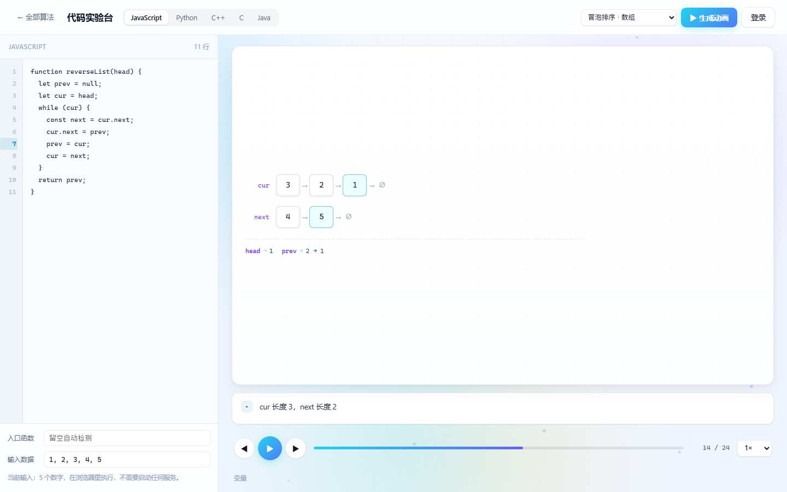 | 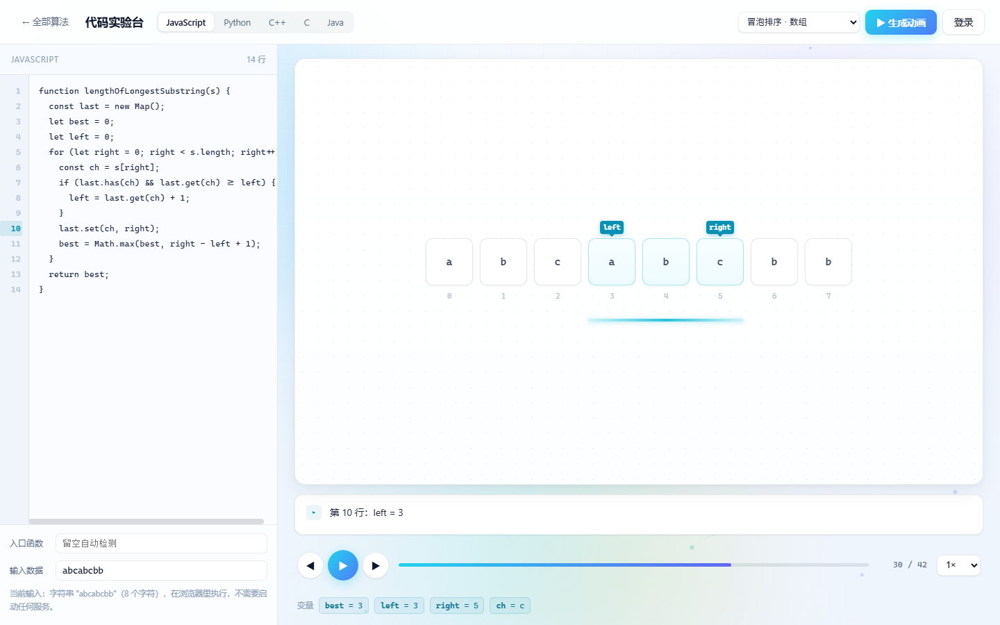 |

| 二维 DP 表 | 二叉树递归 |
| --- | --- |
| 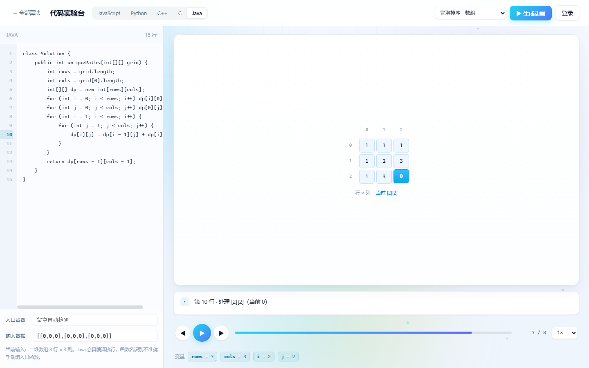 | 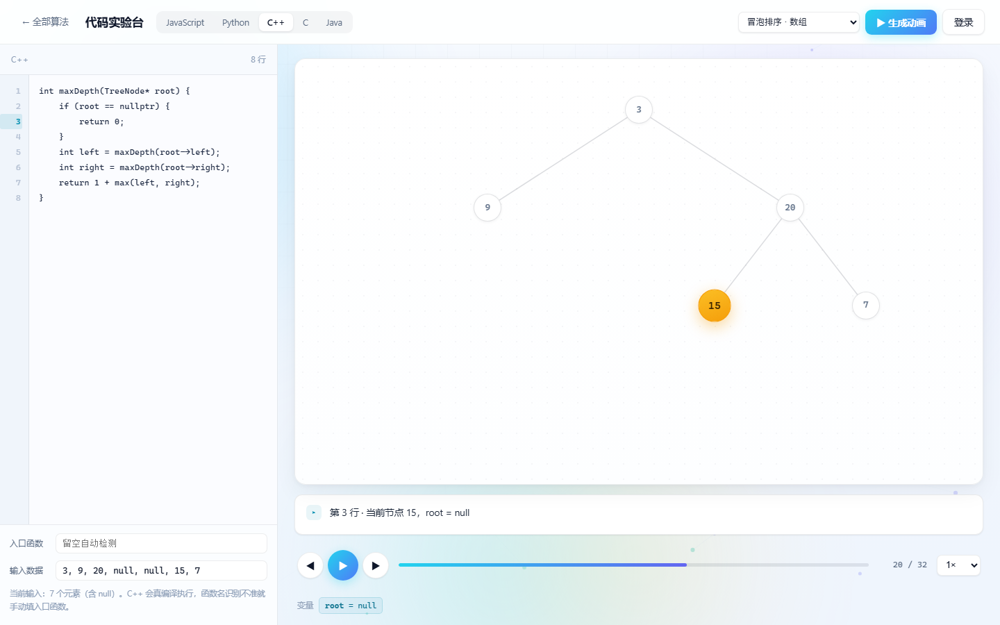 |

| AI 逐行解说（配了 key 才有） |
| --- |
| 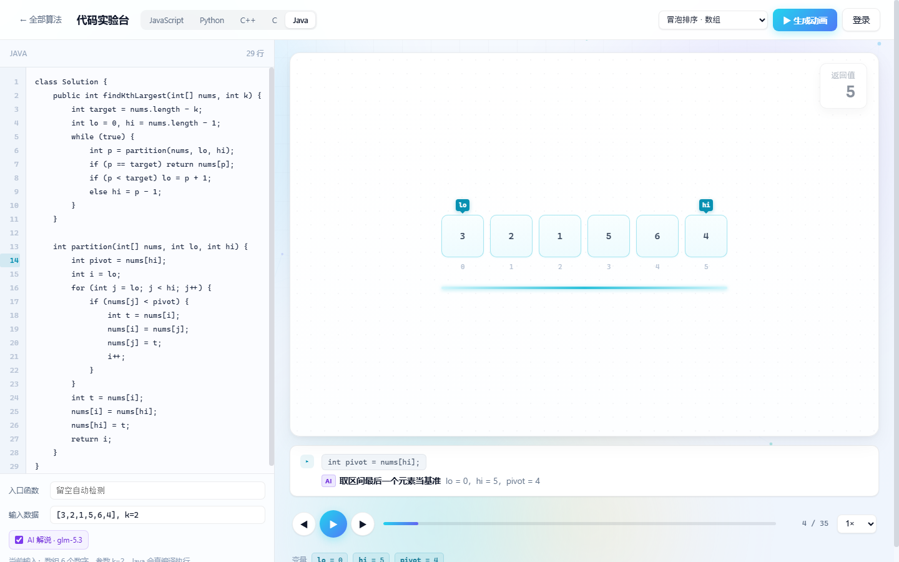 |
| 紫色 `AI` 标签表示这句是模型写的；去掉勾选就退回内置规则 |

| 贪心 + 累计量（LeetCode 135 分发糖果） |
| --- |
| 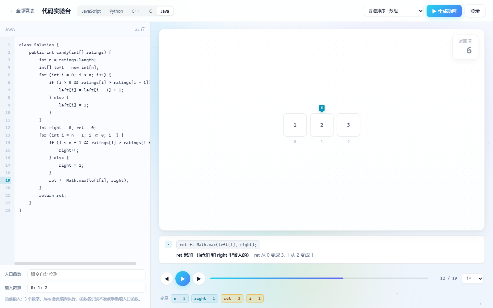 |

| 多方法代码（LeetCode 215 手写快选） |
| --- |
| 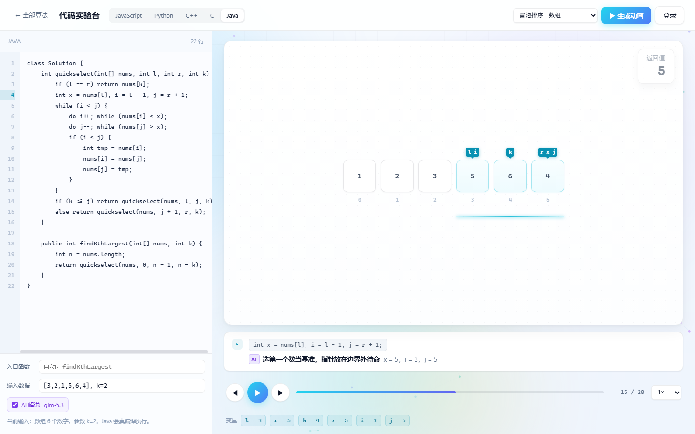 |
| 自动认出入口是 `findKthLargest`（不是它调用的 `quickselect`），`l`/`r` 正确传成 0 和 n-1，28 帧走完返回 5 |
| 辅助数组 `left` 一格格填满，数组不再变化时旁白改讲 `ret 从 3 变成 5`，变化过的变量会高亮 |

### 每一步的解说从哪来

旁白分三段，都对着同一步：

1. **当前代码行**（等宽字体，灰底）——不用回头在左边找
2. **这句在做什么**——按语句类型翻译，例如
   - `left[i] = left[i - 1] + 1` → 把 left[i] 设为 left 的前一项 + 1
   - `ret += Math.max(left[i], right)` → ret 累加（left[i] 和 right 里较大的）
   - `if (i > 0 && ratings[i] > ratings[i - 1])` → 判断：i > 0 且 ratings[i] > ratings 的前一项
   - `for (int i = n - 1; i >= 0; i--)` → 开始倒着循环：i 从 n-1 开始，只要 i >= 0 就继续
   - `return ret` → 返回 ret
3. **变量变化**——这一步到底改了什么（`下标 1 从 0 变成 2`、`ret 从 3 变成 5`）

> 解说只做**语句层面**的翻译，不猜算法意图（"为什么这里要加一"这种需要读题）。想要算法级讲解，得接一个大模型。

### 它是怎么知道该画什么的

| 步骤 | 做法 |
| --- | --- |
| 解析 | JS 用 acorn 拿 AST；C/C++/Java 按行扫；Python 直接 `settrace` |
| 插桩 | 每条语句前插一行快照调用，字符串插入所以原始缩进和注释都保留 |
| 序列化 | 节点带 `.next` 就按链表展开，带 `.left/.right` 就按层序展开（Java/C++/Python 都靠鸭子类型或反射，不依赖具体类名） |
| 选主变量 | 树 → 链表 → 矩阵（`dp`/`memo` 优先）→ 字符串 → 一维数组，同名优先 |
| 认指针 | `i`/`j`/`lo`/`hi`/`left`/`right`/`mid` 这类名字 + 值在下标范围内 |
| 区间高亮 | `left`+`right`、`lo`+`hi` 成对出现时画成一段光带（滑窗 / 二分区间） |
| 合并交换 | `t=a[i]; a[i]=a[j]; a[j]=t;` 三步合并成一帧交换动画 |

### 各语言的坑（都已处理）

- **C/C++ 的数组参数会退化成指针**，`arr` 打印出来是地址 → 用 `__A(arr, n)` 按长度展开。
- **C 模式由 g++ 编译**（runner 统一走 g++），C 写法能跑，C 风格 `struct Node*` 靠参数名识别：`head` 当链表、`root` 当树。
- **C++ 静态方法的返回值**可能是个 `void`，用模板函数转发才能既打印返回值又不编译失败。
- **Java 的类体字段不能插桩**（会变成非法语句），静态方法也不能引用实例字段。
- **`for (int i...) x++;` 这种单语句循环**，`i` 只在循环体内可见，作用域跟踪要单独处理。
- **javac 在 Windows 上输出 GBK**，编译错误要按 GBK 解码，否则满屏乱码。
- **Python 注入节点类会改行号**，所以注入的类用独立的文件名编译，`settrace` 就不会追踪它们。

### 写代码的几个建议

- 把要观察的数据当参数传进来（`sort(arr)`），并**原地修改**它
- 死循环 5 秒后强制终止；最多记录 4000 步
- 多个变量指向同一条链时（`prev` 是 `cur` 的尾部），只有最长的画成链，其余降级成标签

### 入口函数是怎么认的

一份代码里有好几个方法时（LeetCode 215 的 `findKthLargest` 里再调 `quickselect`），
**被别的函数调用过的会被判定为助手**，入口取「没人调用、而且自己会调用别人」的那个。

运行后左侧「入口函数」输入框会显示实际用的是谁（`自动：findKthLargest`）。
认错了就在框里手填方法名，会以你填的为准。

参数按名字对上方法签名：`l` / `lo` / `left` 传 `0`，`r` / `hi` / `right` 传 `n-1`，
`mid` 传中间，`k` 这类显式写了 `k=2` 的用你给的值，其余传数组长度。

### 做不到的

「任何代码都能出动画」是做不到的——动画需要**可画的形态**：

- ✅ 数组 / 字符串 / 矩阵 / 二叉树 / 链表
- ⚠️ 图、并查集、自定义对象：能跑通、能看变量轨迹，但没有图形动画
- ❌ 需要交互输入的代码（`scanf` / `input()`）

界面上也标了这份清单，跑之前就知道能画成什么样。

## 界面

| 冒泡排序（交换中） | BFS 波纹扩散 |
| --- | --- |
| 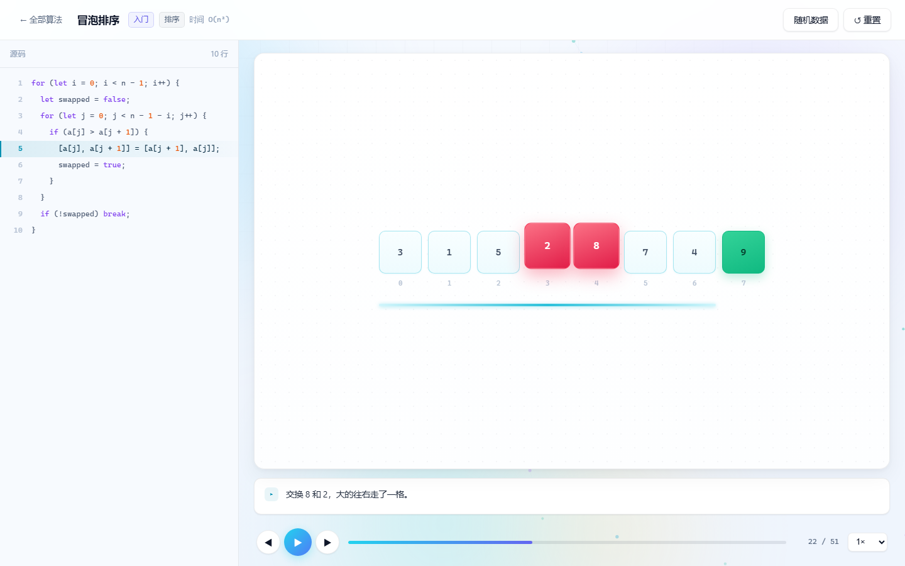 | 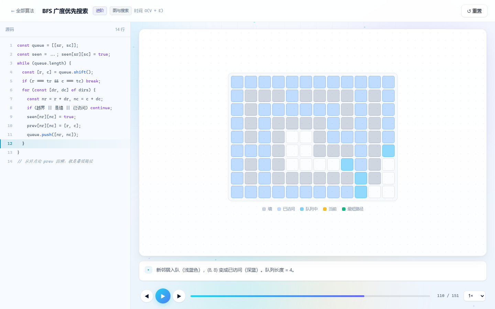 |

| N 皇后回溯 | 二叉树遍历 |
| --- | --- |
| 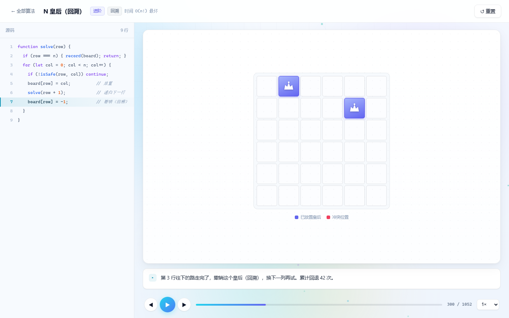 | 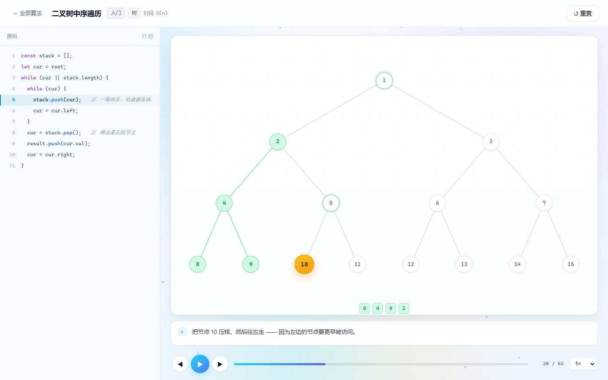 |

| 最长公共子序列填表 |
| --- |
| 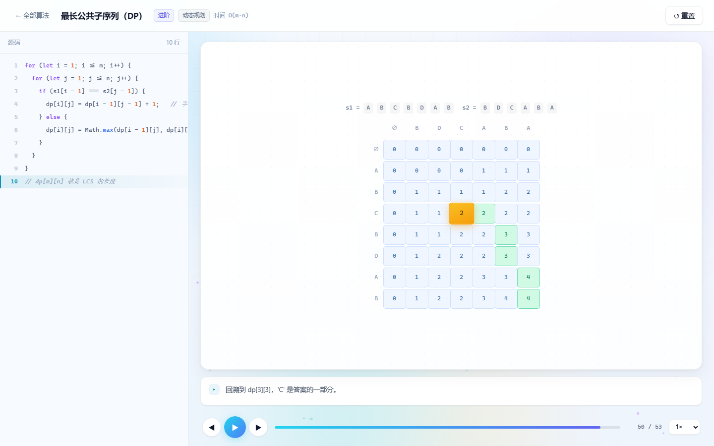 |

## 快速开始

```bash
git clone https://github.com/你的用户名/algo-stage.git
cd algo-stage
npm install
npm run dev          # http://localhost:5175
```

构建：

```bash
npm run build        # 产物在 dist/
npm run preview
```

## 部署

**GitHub Pages**（已配好自动化）：把仓库推到 GitHub，在 Settings → Pages 里把 Source 选成 **GitHub Actions**，之后每次 push 到 `main` 都会自动构建发布。

**Vercel / Netlify**：构建命令 `npm run build`，输出目录 `dist`，直接可用。

> 路由用的是 hash 模式（`#/algo/bubble-sort`），所以任何静态托管都能跑，不用配 SPA 回退规则。
> 线上只有 JavaScript 可用；想让访客也能跑另外四种语言，得把 `runner/` 部署到一台有工具链的服务器，再用 `VITE_RUNNER_URL` 指过去。

## 加一个新算法

整个项目唯一的扩展点就是 `src/algorithms/`。新建一个文件：

```js
// src/algorithms/my-sort.js
export default {
  id: 'my-sort',
  name: '我的排序',
  en: 'My Sort',
  category: '排序',          // 首页的分类筛选会自动出现
  level: '入门',
  view: 'array',             // array | grid | tree | matrix
  complexity: { time: 'O(n)', space: 'O(1)' },
  summary: '一句话说清它在干什么',
  defaultInput: [3, 1, 2],
  inputType: 'array',        // 'array' 会显示「随机数据」按钮，'none' 隐藏
  code: [
    'for (let i = 0; i < n; i++) {',
    '  ...',
    '}'
  ],

  run(input) {
    const steps = []
    const a = [...input]
    // 关键：每一步都 push 一帧快照
    steps.push({ line: 0, desc: '开始遍历', array: [...a] })
    return { steps }
  }
}
```

然后在 `src/algorithms/index.js` 里 import 并塞进 `algorithms` 数组，首页自动出现这张卡片。

### 步骤（step）协议

一帧快照就是一个普通对象，只有 `line` 和 `desc` 是必填，其余按视图取用：

| 字段 | 类型 | 用途 |
| --- | --- | --- |
| `line` | `number` | 高亮第几行代码（从 0 开始） |
| `desc` | `string` | 旁白文案 |
| `array` | `(number\|string)[]` | 数组视图的数据（字符串会摊成字符数组） |
| `compare` | `number[]` | 正在比较的下标 —— 黄色 |
| `swap` | `number[]` | 正在交换的下标 —— 玫红 |
| `sorted` | `number[]` | 已完成的下标 —— 绿色 |
| `pointers` | `{name, index}[]` | 指针标签，如 `{ name: 'i', index: 2 }` |
| `range` | `{from, to}` | 当前处理区间，画成底部那条光带 |
| `aux` | `number[]` | 辅助数组（归并的缓冲区） |
| `grid` | `number[][]` | 网格：`0` 空 `1` 墙 `2` 已访问 `3` 当前 `4` 路径 `5` 队列 `6` 皇后 |
| `nodes` `current` `visited` | - | 树视图 |
| `rows` `badges` | `{name, vals}[]` | 链表视图（多条链 + 指针标签） |
| `matrix` `cell` | `number[][]` / `[r,c]` | 矩阵视图（DP 表） |

## 技术实现

**没有用 D3、没有用 Canvas 画图、没有用动画库。**

- 渲染全部是 DOM + CSS：每个方块就是一个 `div`，状态变化靠加 class，位移靠 `transition`。好处是能用 DevTools 直接检查任意一帧、改样式立刻生效、文字清晰不糊。
- 内置算法**不真的执行用户代码**，而是跑一遍并把过程录成"步骤轨迹"再回放，保证结果确定、可分享到具体某一帧。
- 代码实验台反过来：真的执行（浏览器 Worker / 本地 runner），把每一步的变量快照录下来，再交给同一套渲染组件。
- 树视图的连线用 SVG，节点用百分比绝对定位，随窗口缩放不糊。

```
src/
├── algorithms/          # 内置算法：代码 + 步骤生成器
├── lab/                 # 代码实验台
│   ├── instrument.js    # JS AST 插桩
│   ├── labWorker.js     # 浏览器沙箱执行
│   ├── remote.js        # 多语言 runner 客户端
│   ├── adapter.js       # 变量快照 → 动画帧（选形态、认指针、合并交换）
│   └── samples.js       # 各语言示例
├── components/
│   ├── ArrayView.vue    # 数组方块 + 指针 + 区间光带
│   ├── ListView.vue     # 链表节点链
│   ├── TableMatrix.vue  # 二维表格（DP 表）
│   ├── GridView.vue     # 二维网格（迷宫 / 棋盘）
│   ├── TreeView.vue     # SVG 连线 + 节点
│   └── CodePanel.vue    # 代码高亮 + 当前行跟随
└── views/
    ├── HomeView.vue     # 首页
    ├── AlgoView.vue     # 内置算法舞台
    ├── LabView.vue      # 代码实验台
    ├── AuthView.vue     # 登录注册
    └── WorksView.vue    # 我的作品

runner/                  # 多语言执行服务（Node，零依赖）
├── server.js
└── langs/
    ├── py_tracer.py     # sys.settrace 追踪
    ├── trace.hpp        # C/C++ 追踪头文件（模板探针识别链表/树）
    ├── Trace.java       # Java 追踪工具（反射序列化）
    ├── instr.js         # 行级插桩 + 作用域跟踪
    ├── cpp.js / java.js / python.js
    ├── test-runner.py   # 自测：五种语言跑同一份冒泡
    ├── test-forms.py    # 自测：链表/树/字符串/矩阵
    ├── test-matrix.py   # 自测：语言 × 数据结构分类的矩阵回归（26 例）
    └── test-samples.mjs # 自测：把界面里每个内置示例都跑一遍
```

## 账号与作品（本地）

右上角「登录」可以注册一个本地账号：

- 密码加盐做 SHA-256 后存 `localStorage`，不上传任何地方
- 登录后能把跑通的代码保存成「作品」，下次一键打开接着调
- 支持一键导出 / 导入 JSON 备份

**这是个纯静态站，没有服务器**，所以账号只在当前浏览器有效，换设备或清缓存就没了。请**不要使用真实密码**，它只是个本地身份。

## 已知限制

- 图、并查集、自定义对象只给变量轨迹，没有图形动画。
- AI 解说需要本地 runner + 自己的 key；没配就用内置规则解说（只讲语句，不讲算法意图）。
- Python / C / C++ / Java 需要本地 runner；线上静态站只有 JavaScript 可用。
- C 代码实际是用 `g++` 以 C++17 编译的（能跑绝大多数 C 代码，但严格的 C 语义差异不保证）。
- 支持"一个主数据结构 + 若干标量参数"；两个数组、两个链表这类多结构入参只会给第一个传数据。
- 内置的 8 个算法是预置步骤；实验台走的是动态插桩，两者共用同一套播放器和渲染组件。
- 移动端布局可用，但数组很长时会出现横向滚动。

## License

MIT
